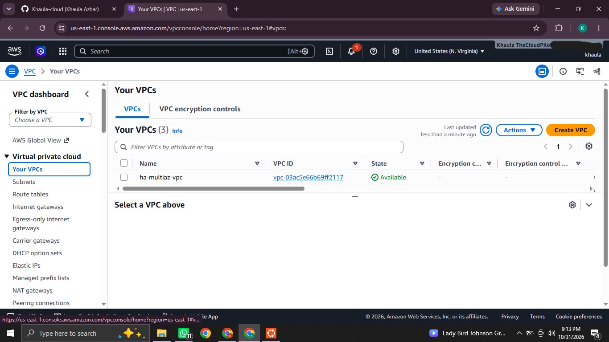
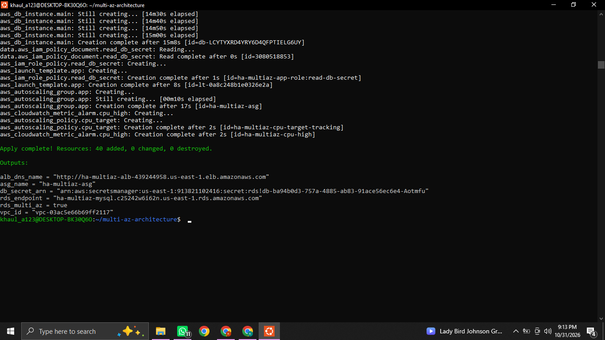
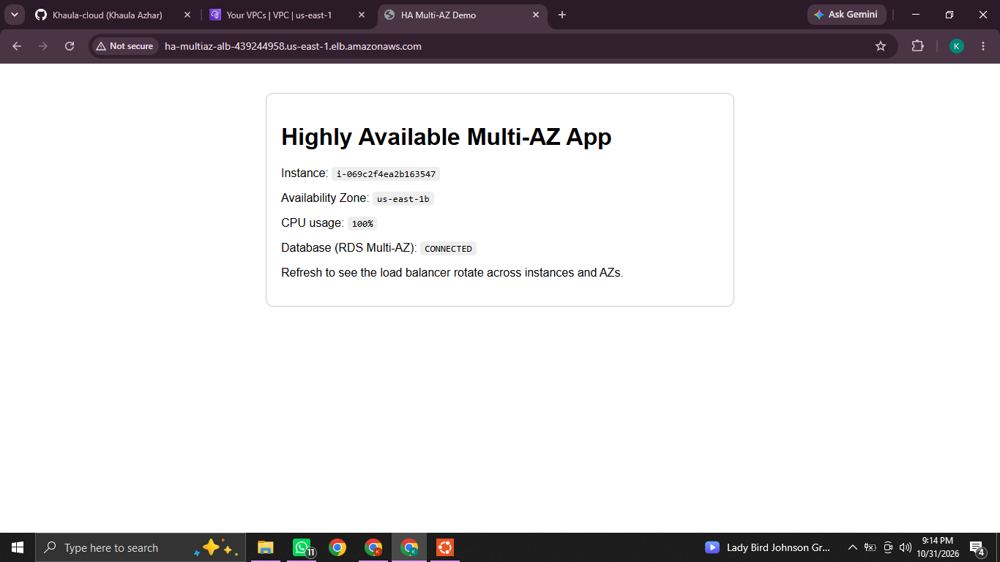
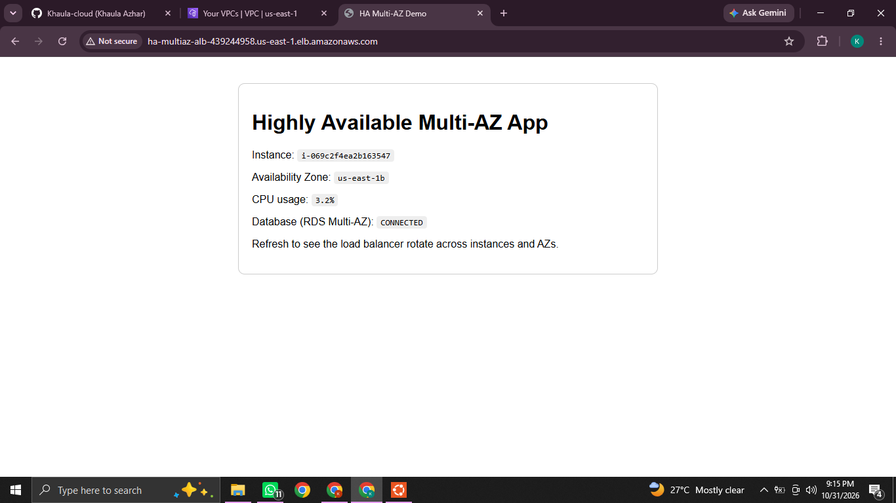
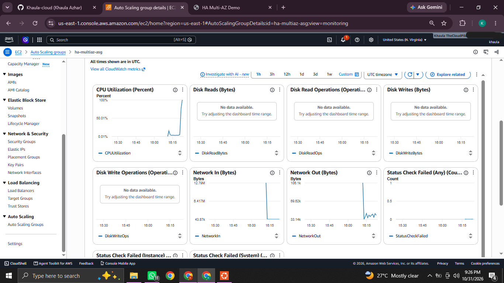
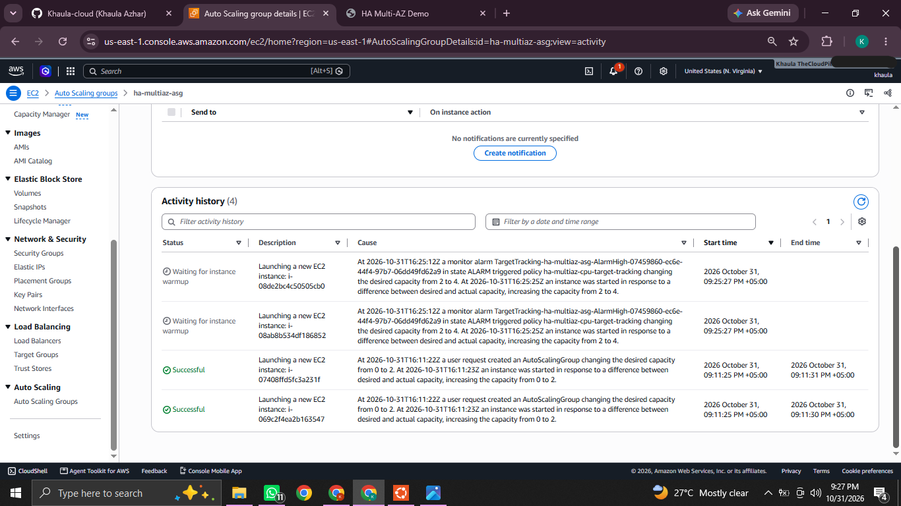
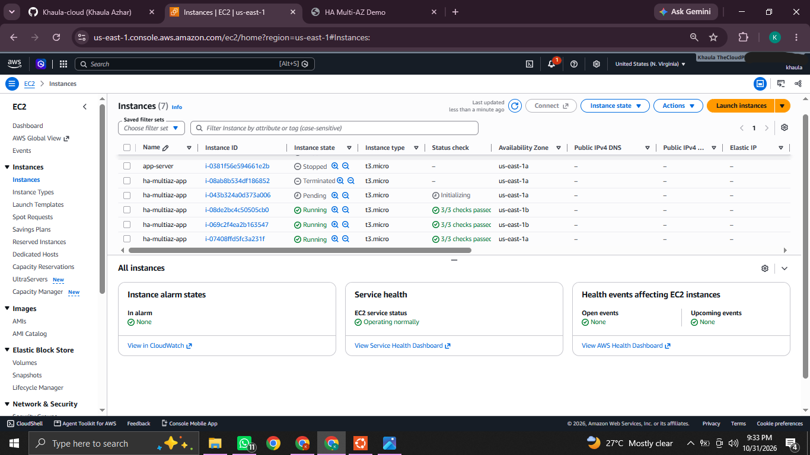
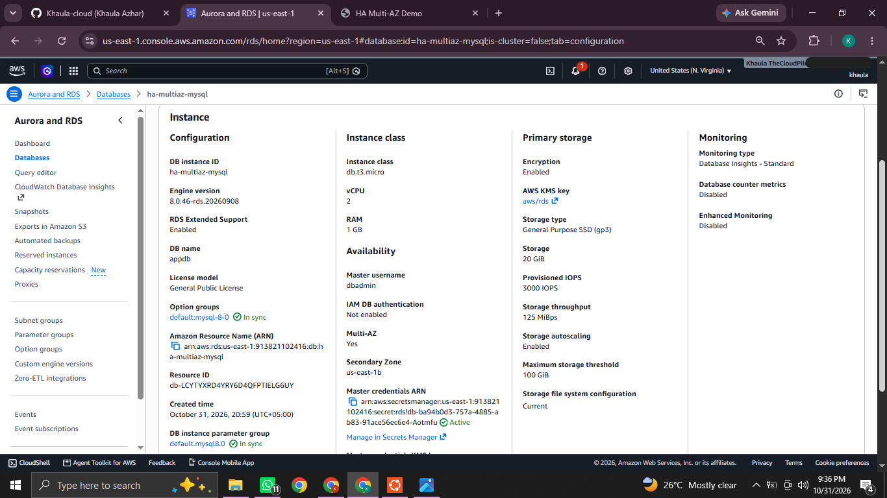
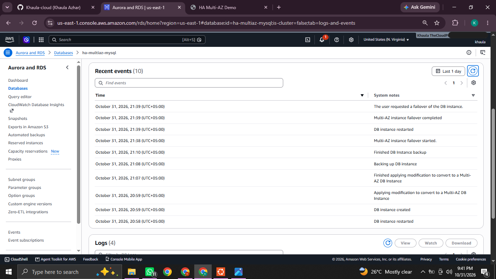
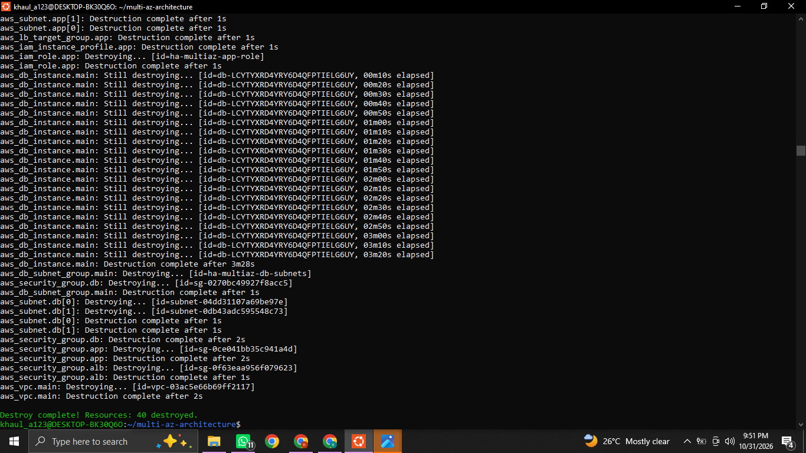

# Highly Available Multi-AZ Elastic Cloud Architecture

A fault-tolerant, auto-scaling web application infrastructure on AWS, built entirely with **Terraform** (Infrastructure as Code). The design survives instance failures, Availability Zone outages and database failures without manual intervention.


---

## Table of Contents
1. [Objective](#objective)
2. [Architecture](#architecture)
3. [Features](#features)
4. [Project Structure](#project-structure)
5. [Prerequisites](#prerequisites)
6. [Deployment](#deployment)
7. [Testing and Results](#testing-and-results)
8. [Security Design](#security-design)
9. [Cost Note](#cost-note)
10. [Clean Up](#clean-up)
11. [Key Learnings](#key-learnings)

---

## Objective
Design a resilient, fault-tolerant corporate application infrastructure that:
- spans multiple physical Availability Zones inside a custom VPC,
- distributes traffic with an Elastic Load Balancer,
- scales EC2 capacity automatically based on CPU utilization,
- stores data in a managed relational database with Multi-AZ replication.

## Architecture

```
                         Internet
                            |
                    [Internet Gateway]
                            |
              Application Load Balancer (cross-zone)
                     |              |
      ===== VPC 10.0.0.0/16 =========================================
      |  AZ-a                       |  AZ-b                        |
      |  Public 10.0.0.0/24         |  Public 10.0.1.0/24          |
      |   [ALB node] [NAT-a]        |   [ALB node] [NAT-b]         |
      |-----------------------------|------------------------------|
      |  App 10.0.10.0/24           |  App 10.0.11.0/24            |
      |   [EC2] [EC2]  <---- Auto Scaling Group (CPU target 50%) -->|
      |-----------------------------|------------------------------|
      |  DB 10.0.20.0/24            |  DB 10.0.21.0/24             |
      |   [RDS PRIMARY] ==sync replication==> [RDS STANDBY]        |
      ================================================================
```

**Traffic flow:** User -> ALB (80) -> EC2 in private subnets (80) -> RDS MySQL (3306).



## Features
| Layer | Implementation |
|---|---|
| Network | Custom VPC, 2 AZs, public / private-app / private-db subnets, one NAT Gateway per AZ |
| Load balancing | Application Load Balancer, cross-zone, `/health` target group checks |
| Compute | Auto Scaling Group + Launch Template (Amazon Linux 2023, IMDSv2, no SSH) |
| Elasticity | Target-tracking policy on average CPU (default 50%), min 2 / max 6 instances |
| Database | RDS MySQL 8.0, Multi-AZ synchronous standby, encrypted, 7-day backups |
| Secrets | DB password generated and stored by AWS Secrets Manager |
| Monitoring | CloudWatch alarms for high CPU and unhealthy targets |
| Access | AWS Systems Manager Session Manager instead of SSH keys |

## Project Structure
```
.
├── versions.tf              # Provider and Terraform version
├── variables.tf             # All configurable inputs
├── vpc.tf                   # VPC, subnets, IGW, NAT, route tables
├── security.tf              # Chained security groups
├── alb.tf                   # Load balancer, target group, listener
├── iam.tf                   # EC2 role and instance profile
├── compute.tf               # Launch template, ASG, scaling policy, alarms
├── database.tf              # Multi-AZ RDS instance
├── outputs.tf               # ALB URL, RDS endpoint, etc.
├── terraform.tfvars.example # Sample variable values
├── scripts/
│   ├── user_data.sh.tftpl   # Instance bootstrap (Apache + status page)
│   ├── load_test.sh         # Triggers CPU load to test scaling
│   └── failover_test.sh     # Forces an RDS failover
├── docs/architecture.md     # Diagram and failure scenarios
└── screenshots/             # Evidence of the running deployment
```

## Prerequisites
- Terraform >= 1.5
- AWS CLI configured (`aws configure`)
- An AWS account with permissions for VPC, EC2, ELB, RDS, IAM, CloudWatch and Secrets Manager

## Deployment
```bash
git clone <your-repo-url>
cd multi-az-architecture

cp terraform.tfvars.example terraform.tfvars
terraform init
terraform plan
terraform apply
```
RDS Multi-AZ takes roughly 10-15 minutes. When it completes, open the `alb_dns_name` output in a browser.





## Testing and Results

### 1. Load balancing across Availability Zones
Refreshing the page shows different instance IDs and AZs as the ALB rotates traffic.



### 2. Auto Scaling on CPU
```bash
./scripts/load_test.sh $(terraform output -raw asg_name) us-east-1 600
```
CPU rises above the 50% target, and the ASG launches additional instances.




### 3. Self-healing
Terminating an instance manually causes the ASG to launch a replacement while the site stays online.



### 4. RDS Multi-AZ failover
```bash
./scripts/failover_test.sh ha-multiaz-mysql us-east-1
```
The standby in the second AZ is promoted automatically, and the application reconnects.




## Security Design
- Instances run in **private subnets**; only the ALB is internet-facing.
- Security groups are chained: `Internet -> alb-sg -> app-sg -> db-sg`.
- The database subnets have **no route to the internet**.
- The database accepts connections **only from the app security group**.
- Storage is encrypted; credentials live in Secrets Manager, never in code.
- IMDSv2 is enforced; access is via SSM, with no open SSH port.

## Cost Note
NAT Gateways, the ALB and Multi-AZ RDS are billed hourly and are **not** covered by the AWS free tier. Destroy the stack after testing.

## Clean Up
```bash
terraform destroy
```



## Key Learnings
- Designing a three-tier network across multiple Availability Zones
- Eliminating single points of failure (per-AZ NAT, Multi-AZ database, cross-zone ALB)
- Dynamic scaling with target-tracking policies
- Least-privilege network design using chained security groups
- Managing infrastructure repeatably with Terraform

## License
MIT

## Author

Khaula Azhar| Cloud Engineer
